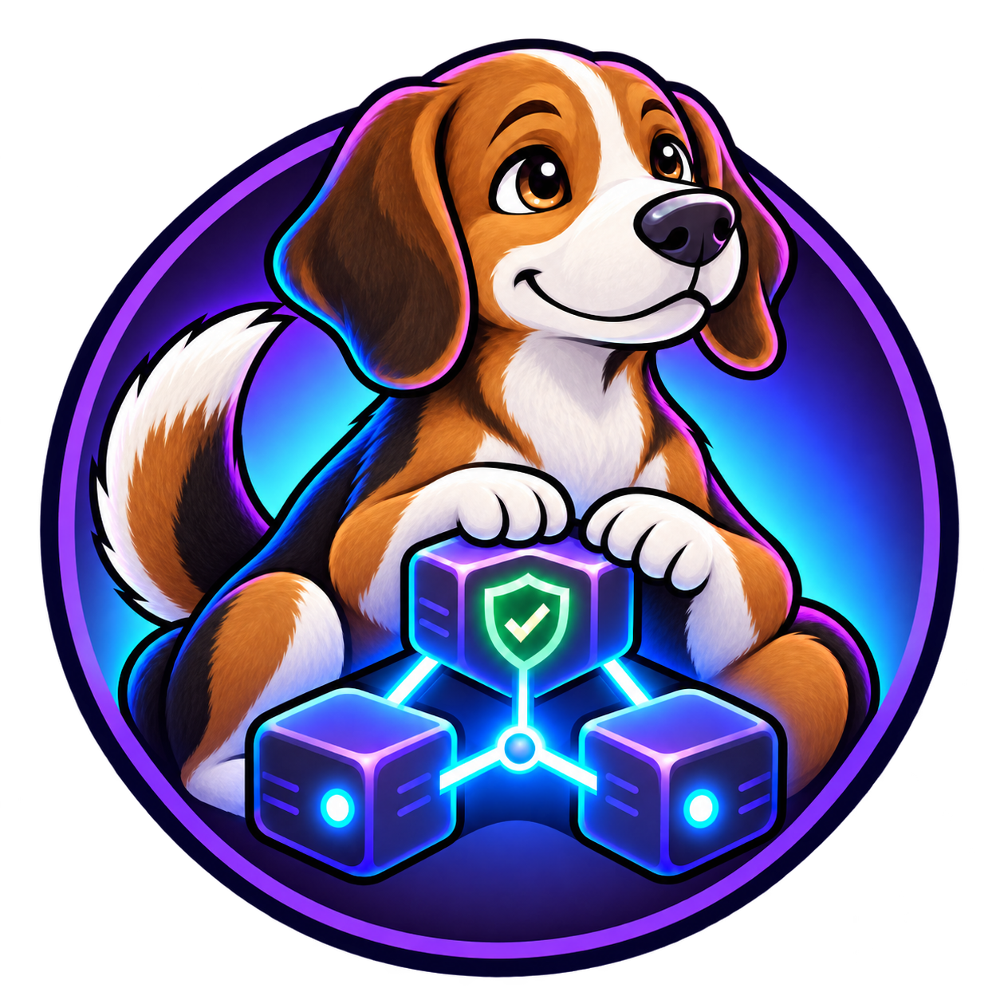

# Obsidian AI Memory

<p align="center">
  
</p>

Sistema local y neutral para usar una única bóveda de Obsidian como memoria persistente compartida entre asistentes de IA en Windows, Linux y macOS.

**Snoop** es la mascota del proyecto: un beagle que protege una memoria local, verificable y compartida entre asistentes.

No añade memoria interna a ningún modelo. Proporciona una fuente de verdad en Markdown, un protocolo seguro de lectura y escritura, y adaptadores para las herramientas que admiten instrucciones locales.

## Compatibilidad

- **Windows, Linux y macOS:** el instalador funciona en los tres sistemas y la bóveda es la misma estructura Markdown local.
- **Codex:** configuración global automática mediante `~/.codex/AGENTS.md` (o `%USERPROFILE%\.codex\AGENTS.md` en Windows).
- **Claude Code:** configuración global automática mediante `~/.claude/CLAUDE.md` (o `%USERPROFILE%\.claude\CLAUDE.md` en Windows).
- **Gemini CLI, Windsurf y GitHub Copilot:** adaptadores opcionales por proyecto incluidos en el repositorio; se copian manualmente y no alteran la configuración global.
- **Cursor, Cline y otras IA:** pueden usar `AI-ONBOARDING.md` o recibir las notas relevantes manualmente hasta verificar una ruta de configuración estable.

Todas comparten el mismo protocolo y la misma bóveda. El proyecto no crea ni modifica automáticamente archivos cuya ruta o formato no se hayan comprobado.

## Qué instala

- Una sola bóveda compartida llamada `MemoriaIA`.
- Un índice inicial y un índice de proyectos.
- Un protocolo que define qué recordar y qué descartar.
- Una plantilla de proyectos conectados mediante enlaces de Obsidian.
- Un documento de incorporación para asistentes genéricos.
- Bloques administrados en las instrucciones globales de Codex y Claude Code.

El instalador conserva el contenido existente de los archivos de configuración. Solo añade o actualiza el bloque delimitado por:

```markdown
<!-- OBSIDIAN-AI-MEMORY:START -->
...
<!-- OBSIDIAN-AI-MEMORY:END -->
```

Antes de modificar un archivo existente crea una copia fechada.

## Instalación rápida

### Windows

1. Descarga el ZIP de la [última versión publicada](https://github.com/overzero18/obsidian-ai-memory-windows/releases/latest) y extráelo.
2. Haz doble clic en `INSTALL.cmd`.
3. Abre `%USERPROFILE%\Documents\ObsidianAI\MemoriaIA` como bóveda en Obsidian.
4. Reinicia las herramientas configuradas.

Desde PowerShell:

```powershell
powershell.exe -NoProfile -ExecutionPolicy Bypass -File .\scripts\Install-ObsidianAIMemory.ps1
```

### Linux y macOS

La forma más sencilla, sin clonar el repositorio, es descargar el pequeño iniciador y ejecutarlo. Descarga el paquete publicado, verifica su SHA-256 y abre el instalador:

```bash
curl -fsSLO https://raw.githubusercontent.com/overzero18/obsidian-ai-memory-windows/main/bootstrap.sh
sh bootstrap.sh
```

También puedes clonar el repositorio si prefieres conservar una copia local:

```bash
git clone https://github.com/overzero18/obsidian-ai-memory-windows.git
cd obsidian-ai-memory-windows
./INSTALL.sh
```

Si el sistema elimina el permiso de ejecución, también puede iniciarse sin modificar permisos:

```bash
sh ./INSTALL.sh
```

La ubicación predeterminada es `~/Documents/ObsidianAI/MemoriaIA`.

Si falta una herramienta para la descarga, instala `curl` y `unzip` con el gestor de paquetes de tu distribución y repite los dos comandos. El instalador no solicita privilegios de administrador ni modifica paquetes del sistema.

Para una copia portátil que se conserva en la carpeta actual:

```bash
sh bootstrap.sh --portable
```

Creará `obsidian-ai-memory-portable/`; puedes cambiar esa ubicación con la variable `OBSIDIAN_AI_MEMORY_PORTABLE_DIR`.

### Modo portátil

Para llevar una bóveda vacía junto al repositorio o archivo descargado, sin modificar configuraciones globales:

```bash
./INSTALL.sh --portable
```

```powershell
.\scripts\Install-ObsidianAIMemory.ps1 -Portable
```

Se crea `portable-data/MemoriaIA` junto al repositorio, se activa únicamente el protocolo genérico y no se toca `~/.codex`, `~/.claude` ni sus equivalentes de Windows. `portable-data/` se excluye de Git.

### Elegir ubicación y nombre

Windows:

```powershell
.\scripts\Install-ObsidianAIMemory.ps1 `
  -BasePath "G:\Obsidian" `
  -VaultName "MemoriaCompartida"
```

Linux y macOS:

```bash
./INSTALL.sh --base-path "$HOME/Obsidian" --vault-name "MemoriaCompartida"
```

### Elegir adaptadores

Solo Codex:

```powershell
.\scripts\Install-ObsidianAIMemory.ps1 -Tools Codex,Generic
```

```bash
./INSTALL.sh --tools codex,generic
```

Solo el protocolo universal, sin modificar configuraciones de herramientas:

```powershell
.\scripts\Install-ObsidianAIMemory.ps1 -Tools Generic
```

```bash
./INSTALL.sh --tools generic
```

### Integrar una bóveda existente

Por seguridad, el instalador se detiene si la carpeta de destino contiene archivos. Para crear una copia completa y añadir únicamente las plantillas que falten:

```powershell
.\scripts\Install-ObsidianAIMemory.ps1 -MergeExisting
```

```bash
./INSTALL.sh --merge-existing
```

`-MergeExisting` y `--merge-existing` nunca reemplazan notas existentes dentro de la bóveda.

## Después de instalar: qué se hace solo y qué decides tú

Al finalizar, el instalador muestra la ruta exacta de un comando de mantenimiento. En la ubicación predeterminada puedes usar:

```bash
~/Documents/ObsidianAI/obsidian-memory doctor
```

```powershell
& "$HOME\Documents\ObsidianAI\obsidian-memory.cmd" doctor
```

El instalador crea una carpeta visible llamada `ObsidianAI-Memory-Tools` junto a la bóveda. Contiene las herramientas necesarias, por lo que estos comandos siguen funcionando aunque se borre la carpeta desde la que instalaste o se utilizó la descarga sencilla.

| Acción | ¿Se hace automáticamente? | Qué hace |
| --- | --- | --- |
| Crear la bóveda y los adaptadores elegidos | Sí, durante la instalación | Añade archivos que faltan y conserva notas existentes. |
| Crear copias fechadas | Sí, antes de modificar archivos existentes | Permite recuperar configuraciones o archivos administrados. |
| `doctor` | No, lo ejecutas tú | Revisa archivos, adaptadores, enlaces, posibles secretos y copias; nunca modifica nada. |
| `update` | No, lo ejecutas tú | Muestra qué archivos administrados se actualizarían; requiere `--apply` o `-Apply` para escribir. |
| `uninstall` | No, lo ejecutas tú | Muestra los bloques gestionados que retiraría; conserva la bóveda y requiere confirmación explícita. |
| `migrate` | No, lo ejecutas tú | Muestra notas antiguas que podría importar; no borra las bóvedas originales y requiere confirmación explícita. |
| Copias programadas o nube | No | El proyecto no crea tareas programadas ni sincroniza datos sin que lo configures. |

Ejemplos de mantenimiento en Linux/macOS:

```bash
~/Documents/ObsidianAI/obsidian-memory
~/Documents/ObsidianAI/obsidian-memory status
~/Documents/ObsidianAI/obsidian-memory doctor
~/Documents/ObsidianAI/obsidian-memory update
~/Documents/ObsidianAI/obsidian-memory update --apply
```

Sin argumentos se abre un menú interactivo en la terminal. `status` ofrece un resumen de la ruta de la bóveda, adaptadores y última copia encontrada, sin modificar nada.

En Windows, sustituye `doctor` por `status`, `update`, `uninstall` o `migrate`; usa `-Apply` únicamente después de revisar la simulación.

## Instalación manual, sin ejecutar el instalador

También puede configurarse únicamente con comandos. Sustituye la ruta por la ubicación deseada.

Linux y macOS:

```bash
mkdir -p "$HOME/Documents/ObsidianAI/MemoriaIA"
cp -R templates/shared-vault/. "$HOME/Documents/ObsidianAI/MemoriaIA/"
mkdir -p "$HOME/.codex"
cp templates/adapters/codex.md.template "$HOME/.codex/OBSIDIAN-AI-MEMORY.md"
```

Después reemplaza `{{VAULT_PATH}}` en el archivo copiado por la ruta real y añade su contenido a `~/.codex/AGENTS.md`. Para Claude, haz lo mismo con `claude.md.template` y `~/.claude/CLAUDE.md`.

Windows PowerShell:

```powershell
$Vault = "$HOME\Documents\ObsidianAI\MemoriaIA"
New-Item -ItemType Directory -Force -Path $Vault
Copy-Item ".\templates\shared-vault\*" $Vault -Recurse
New-Item -ItemType Directory -Force -Path "$HOME\.codex"
Copy-Item ".\templates\adapters\codex.md.template" "$HOME\.codex\OBSIDIAN-AI-MEMORY.md"
```

La instalación manual no edita automáticamente `AGENTS.md` o `CLAUDE.md`, para evitar sobrescribir instrucciones. Copia el bloque adaptado dentro del archivo global correspondiente.

## Cómo funciona la memoria

1. La herramienta lee sus instrucciones globales.
2. Consulta `00 - Inicio.md`.
3. Abre solo las notas relacionadas con la tarea actual.
4. Trabaja normalmente.
5. Conserva únicamente decisiones, preferencias estables, soluciones verificadas y avances útiles a largo plazo.

La conversación y la bóveda cumplen funciones diferentes: el chat mantiene el contexto inmediato; Obsidian conserva conocimiento seleccionado entre sesiones.

El diseño combina índices de proyecto con notas atómicas enlazadas. No obliga a crear una nota para cada conversación: primero busca duplicados y solo conserva información útil a largo plazo.

## Conectar otra IA

Abre `AI-ONBOARDING.md` dentro de la bóveda. Contiene una instrucción reutilizable y explica los límites:

- la IA debe poder acceder a los archivos;
- una aplicación web sin acceso local necesita contexto manual o un conector seguro;
- la bóveda no debe exponerse mediante un servidor público;
- ninguna integración debe almacenar secretos en Markdown.

## Actualizaciones y repetición del instalador

El instalador es repetible:

- actualiza sus bloques administrados;
- conserva las demás instrucciones globales;
- añade plantillas nuevas que no existan;
- no reemplaza notas de la bóveda;
- crea copias antes de integrar contenido existente.

## Diagnóstico y mantenimiento

El proyecto incluye un comando de mantenimiento multiplataforma:

```bash
./scripts/memoryctl.sh doctor
./scripts/memoryctl.sh update
./scripts/memoryctl.sh uninstall
./scripts/memoryctl.sh migrate
```

```powershell
.\scripts\MemoryCtl.ps1 doctor
.\scripts\MemoryCtl.ps1 update
.\scripts\MemoryCtl.ps1 uninstall
.\scripts\MemoryCtl.ps1 migrate
```

`update`, `uninstall` y `migrate` son simulaciones por defecto. Solo escriben al añadir `--apply` o `-Apply`.

Si instalaste con el asistente sencillo, usa preferentemente el comando `obsidian-memory` creado junto a la bóveda. Los comandos dentro de `scripts/` siguen siendo útiles para quien conserva un clon o el ZIP extraído.

Consulta [Mantenimiento](docs/MAINTENANCE.md), [Migración](docs/MIGRATION.md) y el [historial de cambios](CHANGELOG.md) antes de publicar o actualizar una instalación.

## Adaptadores opcionales y recuperación

Hay adaptadores por proyecto para Gemini CLI, Windsurf y GitHub Copilot. Son opcionales, se copian manualmente y no modifican configuraciones globales. Consulta [Adaptadores](docs/ADAPTERS.md).

Las operaciones crean copias fechadas. La [guía de recuperación](docs/RECOVERY.md) explica cómo inspeccionarlas y restaurar archivos concretos de forma segura.

## Versiones y paquetes

La versión actual está en [`VERSION`](VERSION). Al publicar una etiqueta `v*`, GitHub Actions genera un ZIP portátil, su suma SHA-256 y una versión de GitHub con notas automáticas. La descarga sencilla para Linux y macOS usa siempre el último paquete publicado y comprueba su SHA-256 antes de instalar.

Consulta la [guía de publicación](docs/RELEASE.md) para la lista de comprobaciones, la etiqueta y la verificación de descargas.

## Migración desde la primera versión

La primera versión creaba las bóvedas separadas `ChatGptIA` y `ClaudeIA`. Esta versión no las elimina ni combina automáticamente. El nuevo migrador presenta primero una simulación, bloquea posibles secretos, conserva conflictos y nunca borra los originales. Consulta [la guía de migración](docs/MIGRATION.md).

## Privacidad

- Todo se almacena localmente como Markdown.
- No hay base de datos, telemetría ni servidor incluido.
- No se copian conversaciones automáticamente.
- Nunca guardes contraseñas, tokens, cookies, claves API ni credenciales.
- Revisa `git status` y el historial antes de publicar una bóveda.

## Pruebas

El repositorio incluye validación de plantillas y pruebas de integración. Instalan el sistema dos veces en carpetas temporales y comprueban que conserva instrucciones y notas existentes:

```powershell
.\tests\Validate-Templates.ps1
.\tests\Install-ObsidianAIMemory.Tests.ps1
```

```bash
./tests/install-obsidian-ai-memory.test.sh
```

GitHub Actions ejecuta las pruebas en Windows, Ubuntu y macOS con cada cambio y cada pull request.

## Desinstalación

Utiliza primero la simulación descrita en [Mantenimiento](docs/MAINTENANCE.md). El comando seguro retira exclusivamente los bloques administrados y conserva la bóveda.

1. Conserva una copia de las notas que quieras guardar.
2. Elimina solamente los bloques delimitados de los archivos globales de Codex y Claude Code.
3. Elimina la carpeta de la bóveda cuando ya no la necesites.

No borres archivos globales completos: pueden contener instrucciones ajenas a este proyecto.

## Licencia

[MIT](LICENSE)
